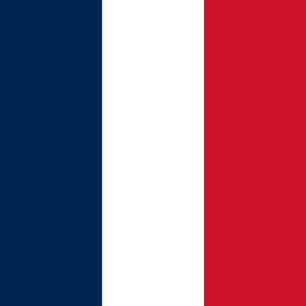

<div align="center">

<table>
 <tr>
  <td><a href="README.md"> English</a></td>
  <td><a href="README_fr.md"> Français</a></td>
  <td><a href="README_es.md"> Español</a></td>
  <td><a href="README_da.md"> Dansk</a></td>
 </tr>
</table>

<br/>

---


---

[](https://github.com/mhaegeman)
[](https://www.linkedin.com/in/maxime-haegeman)
[](https://www.maximehaegeman.com)
[](https://medium.com/@maximehaegeman)

📍 Copenhague, Dinamarca &nbsp;|&nbsp; Abierto a roles de Data Engineering y ML Engineering

</div>

---

```python
class Maxime(DataScientist, DataEngineer):
    """
    Desarrollador que conecta modelos y producción,
    diseñando pipelines de datos y ML escalables.
    """
    def __init__(self):
        self.rol          = "Senior Data / ML Engineer"
        self.base         = "Copenhague, Dinamarca"
        self.experiencia  = 5  # años de experiencia

    def mision(self) -> str:
        return "De datos desordenados a predicciones fiables, a escala."
```

---

## 🔧 Habilidades técnicas

**`lenguajes`**&nbsp;&nbsp;


**`cloud_infra`**&nbsp;


**`data_eng`**&nbsp;&nbsp;


**`ml_stack`**&nbsp;&nbsp;


**`monitoreo`**&nbsp;


**`project_mgmt`**&nbsp;


---

## 🚀 Proyectos seleccionados

| Proyecto | Descripción | Stack |
|---|---|---|
| [**seo-content-generator**](https://github.com/mhaegeman/seo-content-generator) | Herramienta de generación de contenido automatizada optimizada para rendimiento SEO | `Python` `NLP` |
| [**openweather**](https://github.com/mhaegeman/openweather) | Integración con la API de OpenWeather para análisis de datos meteorológicos en tiempo real | `API` `Data Integration` |
| [**scoring-bank-project**](https://github.com/mhaegeman/scoring-bank-project) | Modelo de scoring crediticio y análisis para datos bancarios | `Data Science` `Scoring` |

---

## 🕹️ Gadgets y estadísticas

<div align="center">

[](https://github.com/mhaegeman)
&nbsp;
[](https://github.com/mhaegeman)

<br/>

[](https://github.com/mhaegeman)

[](https://github.com/mhaegeman)

[](https://github.com/mhaegeman)

</div>

---

<div align="center">

Si estás contratando en Copenhague para roles de Data Engineering o ML Engineering, me encantaría conectar.

[](https://www.linkedin.com/in/maxime-haegeman)

</div>
